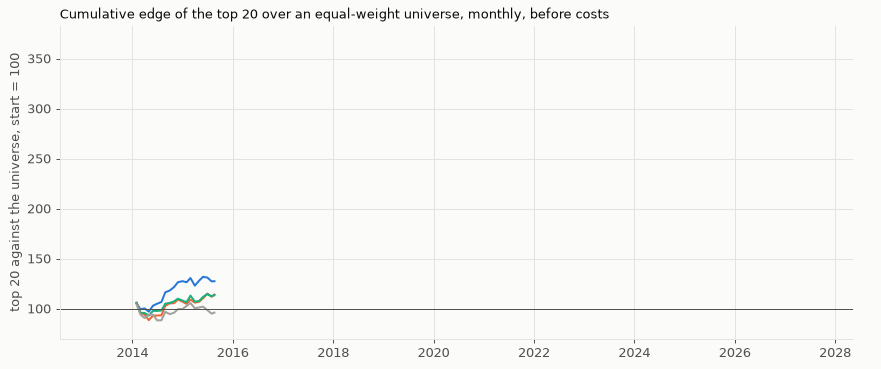

# Momentum After Costs

[](https://github.com/Dhirajdas18/momentum-after-costs/actions/workflows/ci.yml)
[](https://dhirajdas18.github.io/momentum-after-costs/)

Long-only momentum stock selection on NSE: buy the NIFTY 200 stocks that rose most, pay real
delivery charges every time the list changes, and compare what is left with NIFTY and with the
Nifty200 Momentum 30 index and its funds. Daily data from 2007; every score uses only prices known
at the time it is used.

**Live momentum lab: [dhirajdas18.github.io/momentum-after-costs](https://dhirajdas18.github.io/momentum-after-costs/)**,
pick a lookback, number of stocks, rebalance frequency and cost per side and see growth of ₹1 lakh
against the NIFTY ETF and today's ranking, computed in your browser; rebuilt every week from fresh
data by GitHub Actions.

## Features

- [x] The signal out of sample: 12-1, 6-1, 12-0 and 3-month returns and NSE's volatility-adjusted score
- [ ] Survivorship and liquidity: a point-in-time universe against today's list
- [ ] Portfolio construction: number of stocks, weights and sector caps
- [ ] Costs and turnover: delivery charges, rebalance frequency and hold bands
- [ ] Tax: short- and long-term gains and holding periods
- [ ] Momentum crashes: a market filter and volatility scaling
- [ ] Against the Nifty200 Momentum 30 fund and NIFTY after costs and tax

## Findings

### 1. Twelve-month momentum works; a volatility-adjusted score and the latest month help, three months doesn't

<a href="docs/img/signal_compare.png"><picture><source media="(prefers-reduced-motion: reduce)" srcset="docs/img/signal_compare.png"></picture></a>

<a href="docs/img/signal_edge.png"><picture><source media="(prefers-reduced-motion: reduce)" srcset="docs/img/signal_edge.png"></picture></a>

Each month-end from January 2014 to October 2026 (154 months) the universe is the 200 most-traded NSE
stocks by median turnover over the previous 126 days, delisted ones included (a local NSE bhavcopy
archive; only these results are committed). Every signal uses prices to that month-end; the outcome is
the next month's return, before costs, with a stock that stops trading counted as sold at its last
price. 12-1 is the return from 12 months ago to 1 month ago; 12-0 includes the latest month; the
NSE-style score averages 6- and 12-month returns each divided by a year's volatility (an approximation
of the Nifty200 Momentum 30 method, without its weighting and buffers).

- **The top 20 beat the average stock with every 6-12 month signal.** By +10.5% a year with the
  NSE-style score, +9.7% with 12-0, +7.8% with 12-1 and +5.3% with 6-1. The rank correlation with next
  month's return was small but steady (0.032 for the score and 0.033 for 12-1, t 2.2 each).
- **Three months was noise.** Rank correlation 0.004 (t 0.3), +0.0% a year over 2014–19, and its top
  20 changed 54% a month against 28–32% for the 12-month signals.
- **Skipping the latest month didn't help here.** 12-0 kept +9.7% a year against 12-1's +7.8%, with
  the same rank correlation; the textbook one-month reversal didn't show in these stocks.
- **It held in both halves, stronger lately.** The score's edge was +9.1% a year in 2014–19 and +11.7%
  in 2020–26.
- **Today's list flatters everything.** Applying today's NIFTY 200 to the same months, the average stock
  made 25.5% a year against 14.2% for the stocks that were actually most traded at the time, and 12-1's
  top-20 edge rose to +13.2% (finding 2 looks at this).

## Quick start

```bash
uv sync
uv run python scripts/fetch_data.py         # Yahoo Finance -> data/prices.parquet
MO_LAKE_DIR=... uv run mo report signal     # needs a local NSE bhavcopy archive (panel.parquet)
uv run python scripts/build_site.py         # momentum lab -> site/index.html
uv run pytest
```

`scripts/fetch_constituents.py` refreshes the stock list (`docs/data/nifty200.csv`) from NSE's
NIFTY 200 file. Event studies on delisted stocks can read a local NSE bhavcopy archive
(`MO_LAKE_DIR`, with `panel.parquet`); it is optional and not committed.

## Design

- `src/mo/universe.py`: the point-in-time universe (most-traded stocks each month) from a local NSE
  bhavcopy archive set by `MO_LAKE_DIR`; findings that need it say so, and only their results are
  committed.
- `src/mo/signals.py`: the momentum signals and their monthly evaluation (rank IC, top 20 against the
  universe, quintiles).

- `src/mo/data.py`: Yahoo adjusted closes for today's NIFTY 200, NIFTY, NIFTY 200, the NIFTY ETF
  and two Nifty200 Momentum 30 funds (MOMENTUM, MOM30IETF) in one (field, symbol) table; known
  Yahoo errors (unadjusted corporate actions, bad prints, stale history) repaired from
  `docs/data/yahoo_fixes.csv`, each with its source; flags suspicious adjusted-price drops.
- `src/mo/momentum.py`: month-end prices, lookback/skip momentum, a Nifty200 Momentum 30 style
  volatility-adjusted score (an approximation of NSE's methodology), and a long-only top-N
  backtest with equal weights, drifting weights between rebalances and costs on traded value.
- `src/mo/momentum.js`: a line-for-line browser copy of `momentum.py` (without the
  volatility-adjusted score, which needs daily prices), tested against Python through Node.
- `src/mo/site.py`: the momentum lab, one static Plotly page; no server, no committed price data.
- `src/mo/reports.py`: README findings, reproducible with `mo report <topic>`.
- Conventions: decisions at month-end t use prices up to t only and trade at t's close; a held
  stock without a price for a month earns 0 that month; costs are a rate per side on the value
  bought and sold; CAGR is by calendar time.
- Survivorship: the universe is today's NIFTY 200, so stocks that left the index or were delisted
  are missing, which flatters momentum.
- Charts: one validated palette; README charts are animated GIFs with a static fallback for
  reduced-motion users.

Research only, not investment advice. MIT licence.
