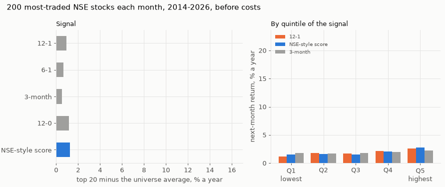
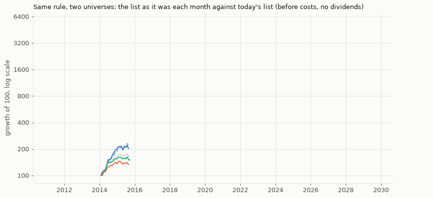
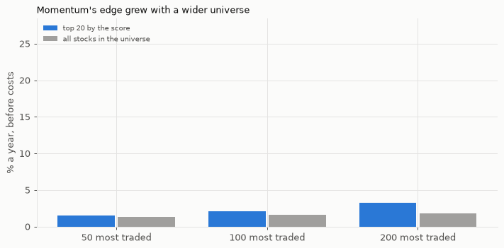
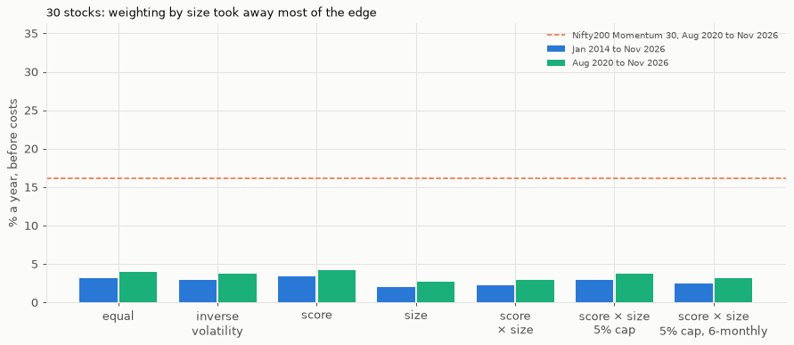
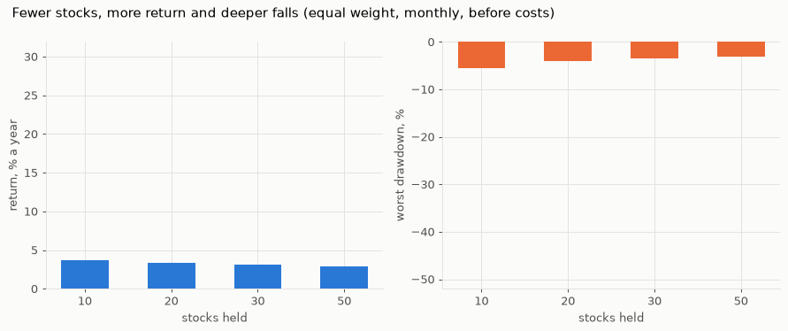
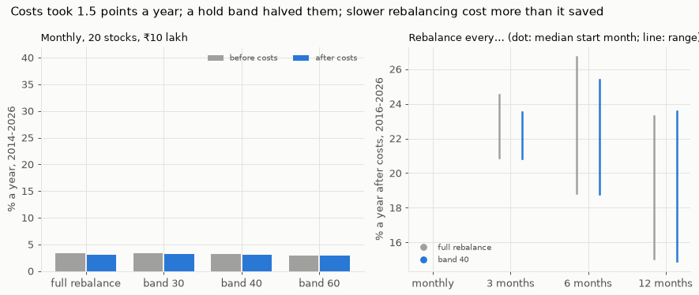
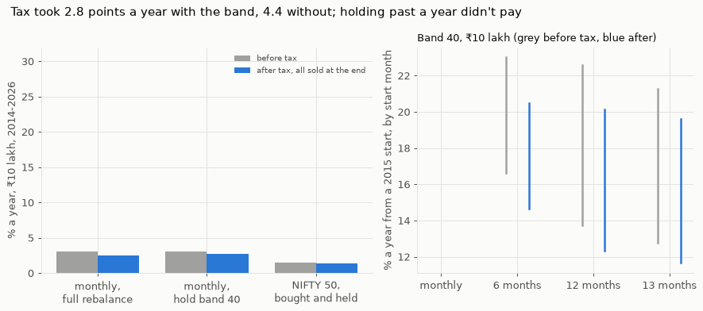
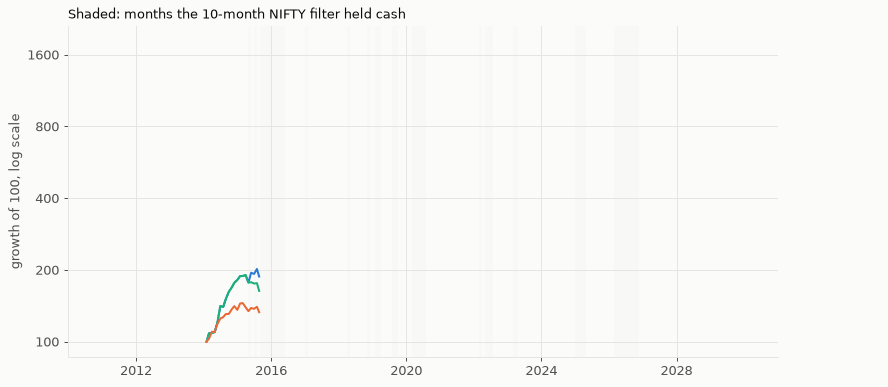
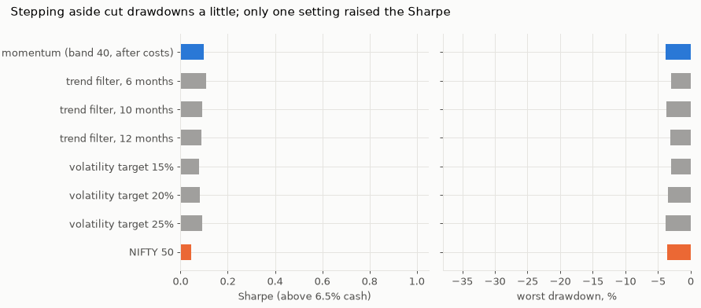
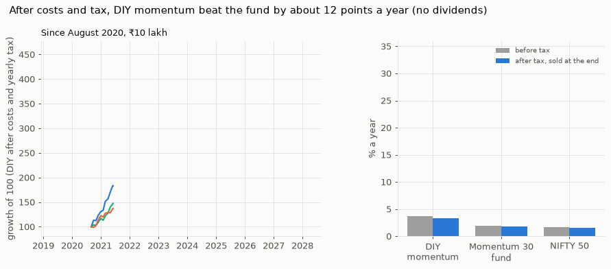

# Momentum After Costs

[](https://github.com/Dhirajdas18/momentum-after-costs/actions/workflows/ci.yml)
[](https://dhirajdas18.github.io/momentum-after-costs/)

Long-only momentum stock selection on NSE: buy the NIFTY 200 stocks that rose most, pay real
delivery charges every time the list changes, and compare what is left with NIFTY and with the
Nifty200 Momentum 30 index and its funds. Daily data from 2007; every score uses only prices known
at the time it is used.

**Live momentum lab: [dhirajdas18.github.io/momentum-after-costs](https://dhirajdas18.github.io/momentum-after-costs/)**,
pick a lookback, number of stocks, rebalance frequency and cost per side and see growth of ₹1 lakh
against the NIFTY ETF and today's ranking, computed in your browser; rebuilt every week from fresh
data by GitHub Actions.

## Features

- [x] The signal out of sample: 12-1, 6-1, 12-0 and 3-month returns and NSE's volatility-adjusted score
- [x] Survivorship and liquidity: a point-in-time universe against today's list, universe size, turnover rule
- [x] Portfolio construction: number of stocks, weights, industry caps, and the gap to the index
- [x] Costs and turnover: delivery charges, rebalance frequency with start-month luck, hold bands
- [x] Tax: short- and long-term gains with lot-by-lot accounting, holding periods, buy and hold
- [x] Momentum crashes: worst spells, a NIFTY trend filter and volatility scaling
- [x] Against the Nifty200 Momentum 30 fund and NIFTY after costs and tax, with a luck test

## Findings

### 1. Twelve-month momentum works best volatility-adjusted; three months doesn't

<a href="docs/img/signal_compare.png"><picture><source media="(prefers-reduced-motion: reduce)" srcset="docs/img/signal_compare.png"></picture></a>

<a href="docs/img/signal_edge.png"><picture><source media="(prefers-reduced-motion: reduce)" srcset="docs/img/signal_edge.png"></picture></a>

Each month-end from January 2014 to October 2026 (154 months) the universe is the day's 200 most-traded
NSE stocks priced at ₹50 or more with a year of history, by median turnover over 126 days, delisted
ones included (built from NSE's daily bhavcopy in a local archive; only these results are committed).
Every signal uses prices to that month-end; the outcome is the next month's return, before costs and
without dividends, with a stock that stops trading counted as sold at its last price. 12-1 is the return
from 12 months ago to 1 month ago; 12-0 includes the latest month; the NSE-style score averages 6- and
12-month returns each divided by a year's volatility (an approximation of the Nifty200 Momentum 30
method, without its weighting and buffers).

- **The top 20 beat the average stock with every 6-12 month signal.** By +10.6% a year with the
  NSE-style score, +9.2% with 12-0, +7.5% with 12-1 and +7.3% with 6-1. The rank correlation with next
  month's return was small but steady: 0.031 for the score and 0.033 for 12-1 (t 2.3 each).
- **Three months was noise.** Rank correlation 0.002 (t 0.2), −0.2% a year over 2014–19, and its top
  20 changed 54% a month against 29–34% for the 12-month signals.
- **Skipping the latest month didn't help here.** 12-0 kept +9.2% a year against 12-1's +7.5%, with
  about the same rank correlation; the textbook one-month reversal didn't show in these stocks.
- **Stronger lately.** The score's edge was +7.8% a year in 2014–19 and +13.1% in 2020–26; 12-1's was
  +4.7% and +9.9%.
- **Today's list flatters everything.** Applying today's NIFTY 200 to the same months, the average stock
  made 25.5% a year against 15.4% for the stocks that were actually most traded at the time, and 12-1's
  top-20 edge rose to +13.2% (finding 2 looks at this).
### 2. Today's list adds 9 points a year; the honest momentum edge is 12 points, but only in a wide universe

<a href="docs/img/universe_survivorship.png"><picture><source media="(prefers-reduced-motion: reduce)" srcset="docs/img/universe_survivorship.png"></picture></a>

<a href="docs/img/universe_size.png"><picture><source media="(prefers-reduced-motion: reduce)" srcset="docs/img/universe_size.png"></picture></a>

The rule: each month-end, hold the 20 stocks with the highest NSE-style score in equal weight; before
costs. Both universes use the archive's prices (no dividends, so the NIFTY lines are price indices
too), January 2014 to November 2026: the point-in-time universe of finding 1, or today's NIFTY 200
(194 of its 200 are in the archive) applied to every month.

- **Today's list adds 9 points a year.** The top 20 made 36.4% a year on today's NIFTY 200 against
  27.1% on the stocks that were actually most traded at the time; the average stock 23.2% against
  15.2%. NIFTY 50 made 11.8%, NIFTY 200 12.9%.
- **The honest edge is large.** On the point-in-time universe the top 20 beat the average stock by
  11.9 points a year, with a worst drawdown of −33.9% against −43.4%. Over those 13 years it held 403
  different stocks, only 166 of them in today's NIFTY 200; 39 stopped trading before the end.
- **Only in a wide universe.** Among the 50 most-traded stocks the top 20 beat the rest by 1.5 points
  a year, among 100 by 4.0, among 200 by 11.9: momentum's winners were mostly outside the largest names.
- **More than the index.** Over August 2020 to November 2026, when the archive has the Nifty200
  Momentum 30 price index, our top 30 rebalanced every 6 months made 25.9% a year against the index's
  16.2% (monthly correlation 0.89). Our version holds stocks in equal weight from the most-traded list;
  the index weights by score × market value within NIFTY 200. Finding 3 tests weighting.
- **Liquidity grew.** The number of the top 200 with a median daily turnover of ₹50 crore (the reference model's
  rule) rose from 64 in 2014 to 200 in 2026; keeping only those, the top 20 made 21.5% a year. A held
  stock traded a median ₹82 crore a day, so ₹50 lakh a stock (a ₹10 crore book) is 0.6% of a day.
### 3. Equal weight kept the edge; weighting by size, as the index does, gave most of it back

<a href="docs/img/portfolio_weights.png"><picture><source media="(prefers-reduced-motion: reduce)" srcset="docs/img/portfolio_weights.png"></picture></a>

<a href="docs/img/portfolio_size.png"><picture><source media="(prefers-reduced-motion: reduce)" srcset="docs/img/portfolio_size.png"></picture></a>

The rule of finding 2 (NSE-style score, point-in-time universe, monthly, before costs, no dividends),
January 2014 to November 2026, with one choice changed at a time. Size is each stock's median daily
turnover, the archive's stand-in for market value; industries come from today's NIFTY 500 list, which
covers 83% of the stocks picked (the rest are not capped).

- **Fewer stocks, more return and deeper falls.** 10 stocks made 30.4% a year with a −45.7% worst
  drawdown; 20 stocks 27.1% and −33.9%; 30 stocks 25.7% and −28.9%; 50 stocks 23.5% and −25.7%.
  Return per unit of volatility was about the same (1.1–1.2).
- **Weighting by size gave most of the edge back.** With 30 stocks: equal weight 25.7% a year, by size
  16.9%, by score × size (the index's idea) 18.3%. Weighting by score alone did a little better than
  equal (28.1%), and inverse volatility a little worse (24.1%).
- **That explains part of the gap to the index.** Over August 2020 to November 2026, equal-weight 30
  stocks made 32.8% a year; score × size 24.3%; with a 5% cap and 6-monthly reviews, closer to the
  index's rules, 25.6%; the index made 16.2%. The rest is likely the universe (most traded against the
  largest by free-float market value) and NSE's buffers.
- **Industry caps cut drawdowns, not return.** At most 3 of 20 from one industry: 27.0% a year with a
  −29.2% worst drawdown, against 27.1% and −33.9% uncapped.
- **Every version traded a lot.** Monthly rebalancing turned over 6–10 times the portfolio a year
  (2.9 times when reviewed every 6 months), which finding 4 prices.
### 4. Delivery costs took 1.5 points a year; a hold band halved them; slower rebalancing lost more

<a href="docs/img/costs_turnover.png"><picture><source media="(prefers-reduced-motion: reduce)" srcset="docs/img/costs_turnover.png"></picture></a>

The top-20 portfolio of findings 2 and 3 with Zerodha's November 2026 delivery charges: STT 0.1% on
each side, stamp duty 0.015% on buys, NSE 0.00322% and SEBI 0.0001% each side with 18% GST, a ₹16
depository charge for every stock sold, and 5 bp slippage a side, on ₹10 lakh. A hold band keeps a held
stock, untouched, while it stays in the top N by score; only stocks that fall out are sold and the money
goes equally to the best-ranked new ones, so winners are not trimmed. Slower schedules are run from every
possible start month and scored over 2016–2026.

- **Costs were small next to the edge.** Monthly with a full rebalance to equal weight: 27.1% a year
  before costs, 25.3% after; costs 1.46% a year on trading 8.4 times the portfolio.
- **A hold band halved them.** Keeping stocks while they stay in the top 40: costs 0.63% a year, trading
  3.7 times, 25.4% after costs; top 30: 0.78% and 26.8%.
- **Slower rebalancing lost more than it saved, and added luck.** Net over 2016–2026, by start month:
  monthly 23.5% (24.1% with the band of 40) whatever the start; every 3 months median 23.0% (range
  20.9–24.5%); every 6 months 23.0% (18.9–26.7%); every 12 months 20.5% (15.0–23.3%).
- **Small portfolios pay more.** The ₹16 per sale is 1.80% a year on ₹2 lakh with a full rebalance
  (0.70% with the band) against 1.38% on ₹1 crore.
- **Slippage didn't change the answer.** At 20 bp a side instead of 5: 23.7% after costs with a full
  rebalance, 24.7% with the band of 40.
### 5. Tax took 2.8 points a year with a hold band and 4.4 without; waiting a year for lower tax cost more

<a href="docs/img/tax.png"><picture><source media="(prefers-reduced-motion: reduce)" srcset="docs/img/tax.png"></picture></a>

The portfolio of finding 4 (₹10 lakh, delivery charges) simulated in rupees with every purchase kept
as its own lot, sold first in, first out. Gains on stocks held 12 months or less are short-term, taxed
at 20%; longer, long-term at 12.5% above ₹1.25 lakh a year; plus 4% cess (FY 2026-27 rates, which Budget
2026 left unchanged, applied to every year). Losses are set off and carried forward; each year's tax is
paid out of the portfolio at the end of March. "After selling" also pays tax on the gains still unsold at
the end. NIFTY 50 is bought once and taxed once, on the sale.

- **Tax took more than costs.** Monthly with a full rebalance: 25.3% a year before tax, 20.9% after
  selling everything at the end; 87% of realised gains were short-term.
- **The hold band halved the damage.** Keeping stocks while they stay in the top 40 let winners pass a
  year: 38% of gains short-term, 25.4% before tax, 22.6% after. NIFTY 50 bought and held made 11.8%
  before tax, 10.9% after.
- **Waiting for long-term rates cost more than it saved.** Rebalanced every 13 months, only 5% of gains
  were short-term, but over every start month from 2015 it made a median 17.6% before tax and 16.2%
  after, against 21.1% and 18.9% for monthly with the band over the same span. Every 6 and 12 months
  sat in between (after tax, medians 17.7% and 16.1%).
- **Size barely mattered.** On ₹1 crore the band made 22.2% after tax against 22.6% on ₹10 lakh: the
  ₹1.25 lakh exemption is worth less to a bigger portfolio.
### 6. No classic momentum crash here; its bad spells were mid-cap sell-offs, and stepping aside didn't reliably help

<a href="docs/img/crash_paths.png"><picture><source media="(prefers-reduced-motion: reduce)" srcset="docs/img/crash_paths.png"></picture></a>

<a href="docs/img/crash_overlays.png"><picture><source media="(prefers-reduced-motion: reduce)" srcset="docs/img/crash_overlays.png"></picture></a>

The monthly band-40 portfolio after delivery costs (findings 4 and 5), February 2014 to November 2026,
before tax and without dividends; cash earns 6.5% a year. The trend filter holds cash for a month when
NIFTY ended the last month below its average of the last 6, 10 or 12 month-ends. Volatility scaling
holds target ÷ the portfolio's volatility over the last 12 months (never more than fully invested).
Moving in and out costs about 0.17% a side; the tax on those extra sales is left out. The archive
starts in 2013, so 2008 and its rebound are not in it.

- **No rebound crash.** The textbook momentum crash comes when a falling market turns up sharply. Here,
  in the 26 months NIFTY rose more than 5%, momentum matched the average stock (+0.04% a month); in
  months below NIFTY's 10-month average its edge was larger (+10.4% a year against +8.6%).
- **Its bad spells were mid-cap sell-offs.** Worst months: March 2020 −22.5% (NIFTY −23.2%), January 2025
  −15.1% (NIFTY −0.6%), September 2018 −14.9% (NIFTY −6.4%). Its deepest drawdowns, −31.5% to March 2020
  and −29.6% from July 2024 to February 2025, were deeper than NIFTY's in the second case (−14.3%).
- **Stepping aside lowered return and mostly lowered the Sharpe.** Momentum alone made 24.8% a year with
  a Sharpe of 0.81 (NIFTY 0.37). A 10-month filter made 19.1% (Sharpe 0.75), 12 months 20.1% (0.72);
  only 6 months raised it (21.6%, Sharpe 0.90, worst drawdown −24.3%). Volatility targets of 15–25% gave
  Sharpes of 0.64–0.76.
- **One good setting among six is not a rule.** The 6-month filter's gain sits next to two filter
  lengths that lost, and every filter adds taxable sales; none is a reliable improvement on these years.
### 7. After costs and tax, DIY momentum beat the Momentum 30 fund by 12 points a year, but its design was chosen on these years

<a href="docs/img/verdict.png"><picture><source media="(prefers-reduced-motion: reduce)" srcset="docs/img/verdict.png"></picture></a>

₹10 lakh in the rule built in findings 1–5: each month the 20 most-traded stocks' best NSE-style
scores, equal weight, a hold band of 40, Zerodha delivery charges, and short- and long-term gains tax
paid each March, with everything sold at the end. The fund is the Nifty200 Momentum 30 price index less a
0.3% yearly fee (fund factsheets show 0.24–0.32%), bought once and taxed once on the sale; NIFTY 50 the
same with no fee. The archive has the index from August 2020. No dividends anywhere.

- **The fund made a little more than NIFTY.** August 2020 to November 2026: Momentum 30 fund 15.8% a year
  before tax, 14.5% after; NIFTY 50 13.7% and 12.5%.
- **DIY made far more.** 30.3% a year before tax, 26.8% after, over the same months; from January 2014,
  25.4% and 22.6% against NIFTY's 11.8% and 10.9%.
- **Unlikely to be luck alone.** The monthly edge over NIFTY (+13.1% a year, 2014–2026, after costs) had
  a 0.3% chance with no real edge in a 12-month block bootstrap; over the fund (+13.6%, 75 months), 0.5%.
  Trading the day after the signal instead of at its close cost 0.4 points a year.
- **But the rule was designed on the same years.** The score, 20 stocks and the band of 40 were chosen in
  findings 1–4 by comparing choices over 2014–2026, the bootstrap doesn't allow for that search, and the
  edge leans on mid-sized companies that the index weights down (finding 3) during a strong decade for
  them. Weighting by size, as the index does, gave most of it back.
- **The fund does what it says.** Motilal Oswal's Momentum 30 ETF made 10.73% a year from August 2022
  against the price index's 10.55%, so the fund pays the index's dividends and its fee is small.

## Quick start

```bash
uv sync
uv run python scripts/fetch_data.py         # Yahoo Finance -> data/prices.parquet
MO_LAKE_DIR=... uv run mo report signal     # also: universe, portfolio, costs, tax,
                                            # crash, verdict
uv run python scripts/build_site.py         # momentum lab -> site/index.html
uv run pytest
```

`scripts/fetch_constituents.py` refreshes the stock list (`docs/data/nifty200.csv`) from NSE's
NIFTY 200 file. Event studies on delisted stocks can read a local NSE bhavcopy archive
(`MO_LAKE_DIR`, with `panel.parquet`); it is optional and not committed.

## Design

- `src/mo/universe.py`: the point-in-time universe (each day's 200 most-traded stocks at ₹50 or more
  with a year of history) from a local NSE bhavcopy archive set by `MO_LAKE_DIR`; findings that need it say so, and only their results are
  committed.
- `src/mo/tax.py`: a rupee simulator of the same rule with first-in, first-out lots, short- and
  long-term gains, set-off, carried losses and yearly tax; its pre-tax path matches the backtest.
- `src/mo/crash.py`: the trend filter, volatility scaling and drawdown table, each deciding at one
  month-end for the next month.
- `src/mo/luck.py`: a circular block bootstrap of monthly excess returns (the chance of an edge this
  large with none).
- `src/mo/signals.py`: the momentum signals and their monthly evaluation (rank IC, top 20 against the
  universe, quintiles).

- `src/mo/data.py`: Yahoo adjusted closes for today's NIFTY 200, NIFTY, NIFTY 200, the NIFTY ETF
  and two Nifty200 Momentum 30 funds (MOMENTUM, MOM30IETF) in one (field, symbol) table; known
  Yahoo errors (unadjusted corporate actions, bad prints, stale history) repaired from
  `docs/data/yahoo_fixes.csv`, each with its source; flags suspicious adjusted-price drops.
- `src/mo/momentum.py`: month-end prices, lookback/skip momentum, a Nifty200 Momentum 30 style
  volatility-adjusted score (an approximation of NSE's methodology), and a long-only top-N
  backtest with equal weights, drifting weights between rebalances and costs on traded value.
- `src/mo/momentum.js`: a line-for-line browser copy of `momentum.py` (without the
  volatility-adjusted score, which needs daily prices), tested against Python through Node.
- `src/mo/site.py`: the momentum lab, one static Plotly page; no server, no committed price data.
- `src/mo/reports.py`: README findings, reproducible with `mo report <topic>`.
- Conventions: decisions at month-end t use prices up to t only and trade at t's close; a held
  stock without a price for a month earns 0 that month; costs are a rate per side on the value
  bought and sold; CAGR is by calendar time.
- Survivorship: the universe is today's NIFTY 200, so stocks that left the index or were delisted
  are missing, which flatters momentum.
- Charts: one validated palette; README charts are animated GIFs with a static fallback for
  reduced-motion users.

Research only, not investment advice. MIT licence.
